# Mossgrove for React Native: an NthCase sample app

Mossgrove is a small, fictional shop for home and desk goods. It is built to be tested with
[NthCase](https://nthcase.com), the AI testing platform that records and replays tests on Android, iOS and the web.
Clone it, build it, and run your first NthCase test on it in minutes.

It is one of five identical Mossgrove apps. The same screens, test ids, texts and scenarios are built in Kotlin +
Jetpack Compose, SwiftUI, Flutter, React Native with Expo (this one) and Ionic, all from one spec: [SPEC.md](SPEC.md),
**spec 1.0**. Every verb NthCase supports has a place to land, and so do the hard cases real apps have: a slow screen,
a failed load with retry, a web view, a system permission prompt, a modal, and a screen with no test ids at all.

- No network, no analytics, no ads, no tracking. Everything is seeded inside the app, so every run is the same.
- One codebase for Android and iOS: React Native 0.88 with Expo SDK 58, TypeScript, the New Architecture and
  `expo-router`.

| Sign in | Shop | Item | Cart |
| --- | --- | --- | --- |
| 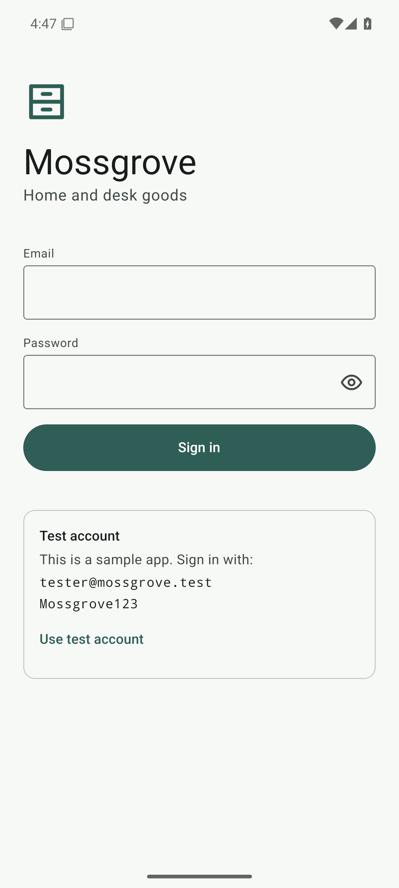 | 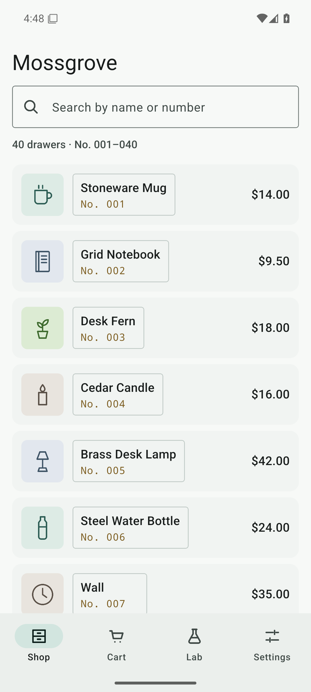 | 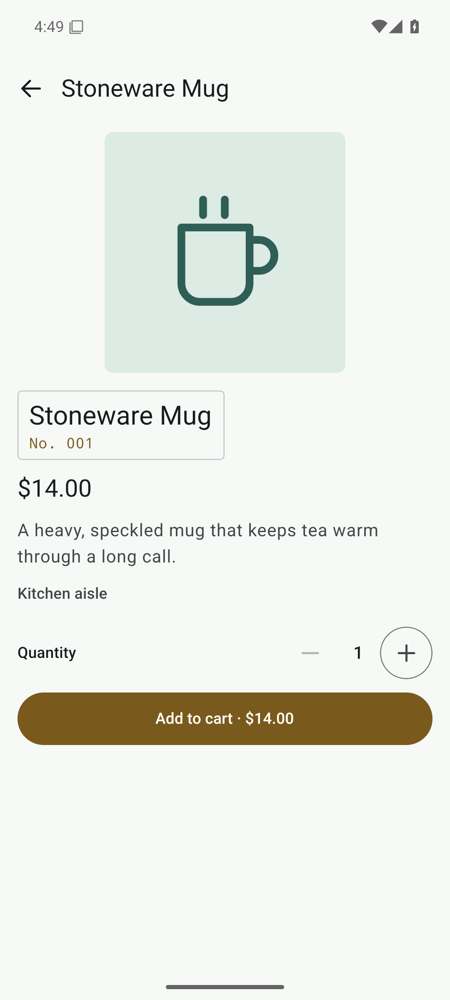 | 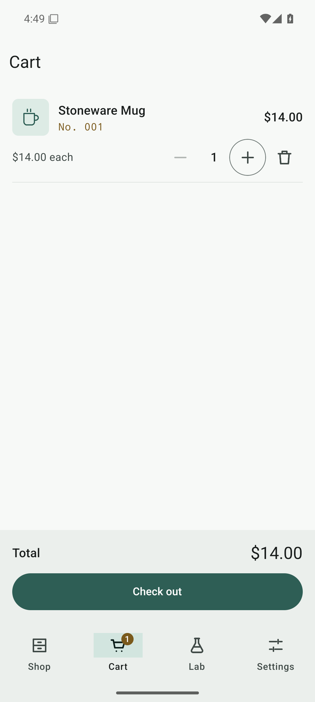 |
| Modal | Lab | Form errors | Form done |
| 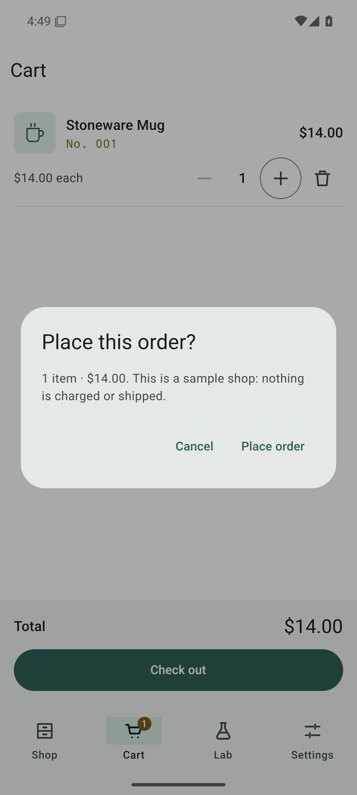 | 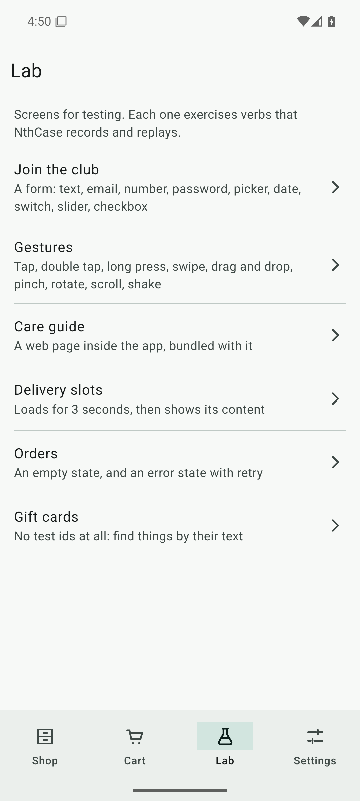 | 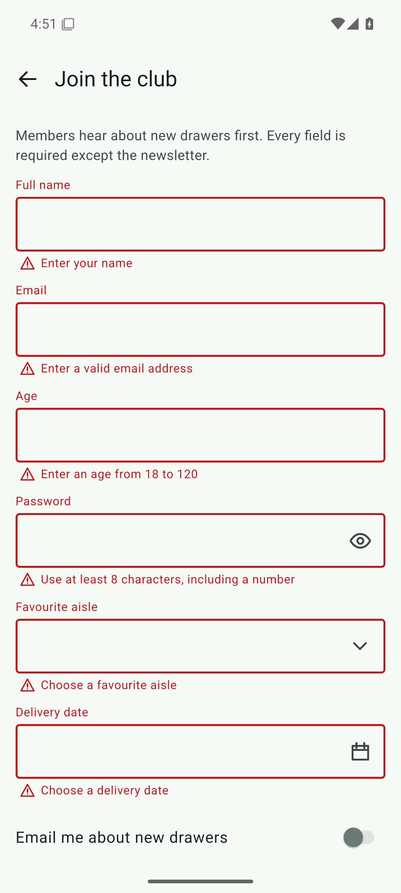 | 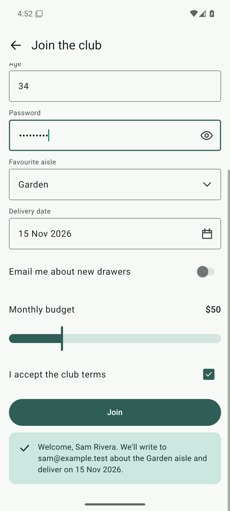 |
| Gestures | Delivery slots | Error + retry | No test ids |
| 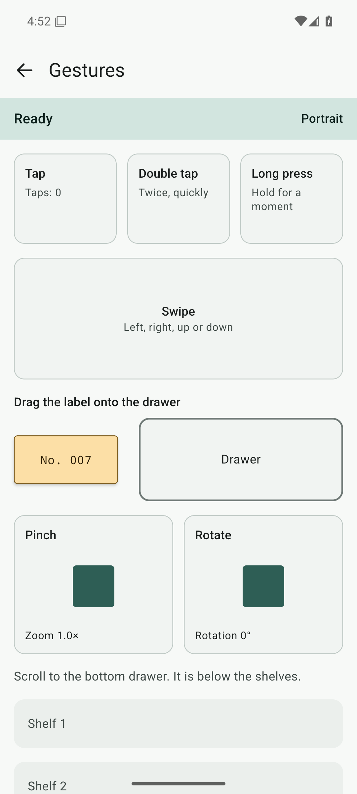 | 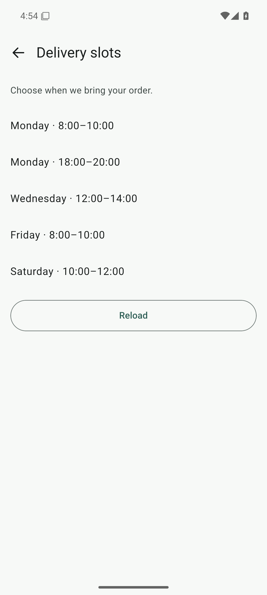 | 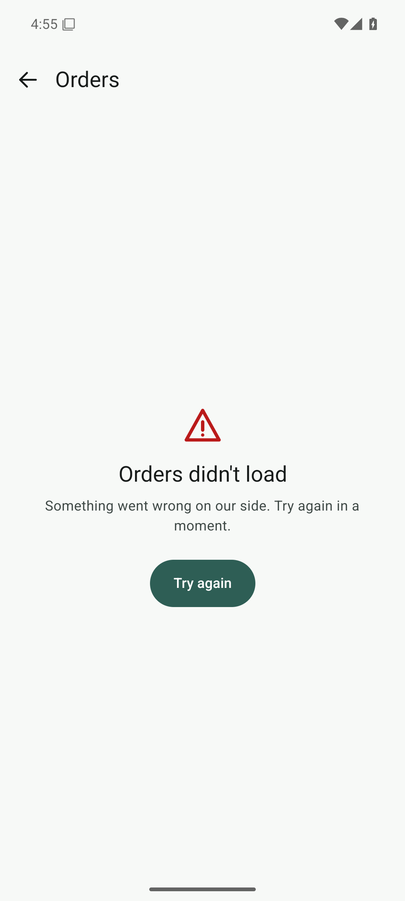 | 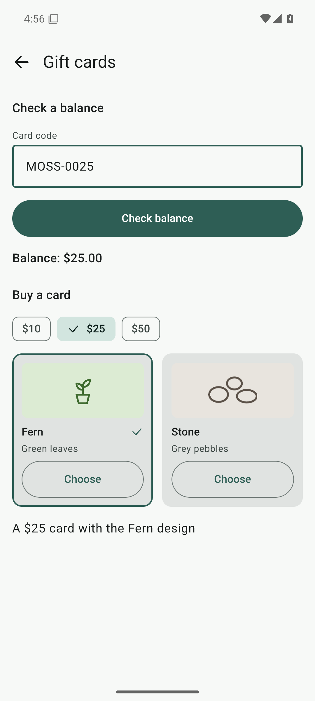 |
| Settings | Settings dialog | Empty search | Deep link, unknown id |
| 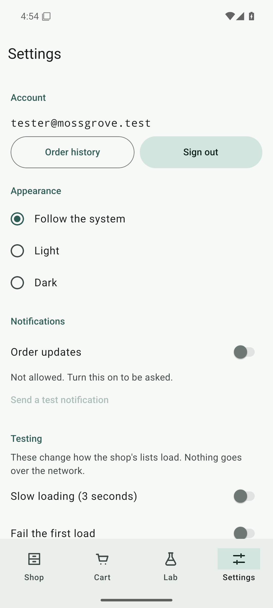 | 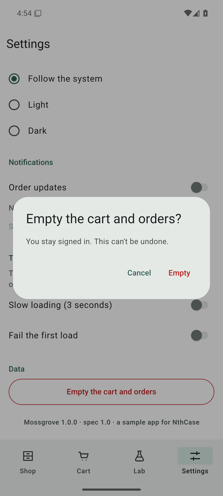 | 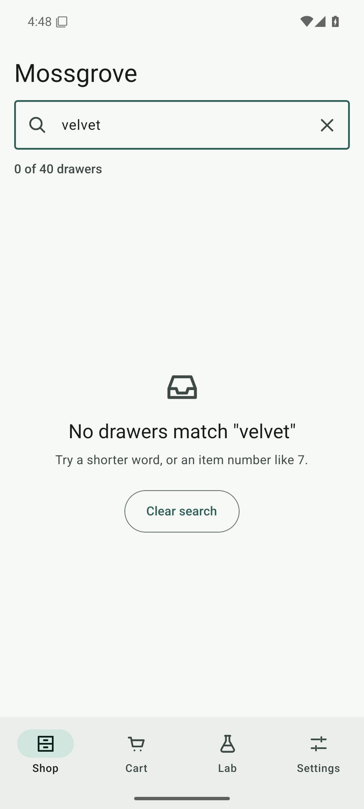 | 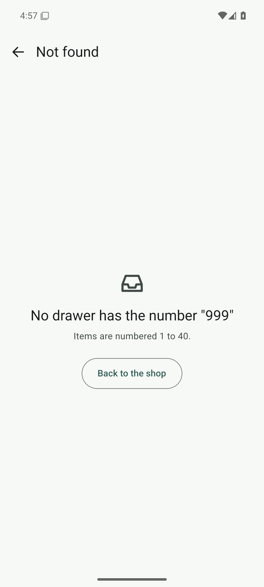 |

All 24 screens, light and dark, go in [docs/screenshots](docs/screenshots). They are taken on an Android emulator in
CI, not on a developer's machine; [docs/screenshots/README.md](docs/screenshots/README.md) says how.

## Test account

| | |
| --- | --- |
| Email | `tester@mossgrove.test` |
| Password | `Mossgrove123` |
| Gift-card code | `MOSS-0025` |
| Deep link | `nthcase-sample://item/{1–40}` |
| Package / bundle id | `com.nthcase.sample` (Android and iOS) |

The account is printed on the sign-in screen too, with a **Use test account** button.

## Build

You need Node 22 and npm. For Android: JDK 17 or newer (21 is what CI uses) and the Android SDK (`ANDROID_HOME`).
For iOS: a Mac with CocoaPods and an Xcode newer than 26.2 (Expo SDK 58's `ExpoModulesJSI` does not compile with Xcode 26.2's Swift 6.2.3; CI uses the newest stable Xcode on `macos-latest`).

```bash
npm ci
npm test                  # Jest: logic, the scenarios' flows, the id census
npm run typecheck         # tsc --noEmit
```

`android/` and `ios/` are not in the repository. Expo generates them from `app.json` and the local config plugin in
`plugins/` (Continuous Native Generation):

```bash
npx expo prebuild --clean
```

**Android**, a release build with the JavaScript bundle inside, signed with the debug keystore as Expo's template does:

```bash
cd android && ./gradlew assembleRelease --no-daemon --max-workers=3
```

The APK is `android/app/build/outputs/apk/release/app-release.apk`. It is **debug-signed**, so anyone can install it,
and it runs on its own: no Metro server, no dev client, no live reload. Every [release](../../releases) has a
ready-built one, named `mossgrove-react-native-<tag>-debug.apk`.

**iOS**, the Release configuration for the Simulator (arm64 and x86_64), unsigned, with the bundle inside:

```bash
scripts/build-ios-simulator.sh
```

It writes `dist/mossgrove-react-native-local-simulator.zip`, which holds `Mossgrove.app`. Unzip it and install it with
`xcrun simctl install <udid> Mossgrove.app`. There is no `.ipa`: that needs signing.

| | |
| --- | --- |
| Language and UI | TypeScript, React Native 0.88 (New Architecture, Hermes), Expo SDK 58, `expo-router` |
| Platforms | Android: minSdk 26 (Android 8.0), compileSdk 37, targetSdk 36. iOS: 17.0 and later |
| Native folders | generated by `npx expo prebuild`; settings live in `app.json` and `plugins/withMossgroveAndroid.js` |
| Tests | Jest with `jest-expo` and React Native Testing Library |
| Permissions | Android: `POST_NOTIFICATIONS` only. No `INTERNET`: the app cannot reach the network. |

## Test it with NthCase

1. Install the build on an emulator, a simulator or a test phone: `adb install` the APK, or `xcrun simctl install`
   the `.app`.
2. Connect the device to NthCase with the agent: `npx nthcase-agent@latest`. The NthCase docs, under *Your
   devices*, walk through it. Or use a cloud device.
3. In NthCase, add an app with the package / bundle id `com.nthcase.sample`, and upload the build.
4. Create a scenario from one of the files in [nthcase/scenarios](nthcase/scenarios): its numbered lines are the
   steps, and each `Expect:` line is that step's check. Or record one: **Scenarios → New scenario → Record**.
5. Compile it, and run it.

With NthCase's MCP server, ask your assistant to "create a scenario from nthcase/scenarios/03-cart-and-order.md for
Mossgrove and run it on my Android phone".

## What it covers

| NthCase verb | Where | Scenario |
| --- | --- | --- |
| launch, tap, type | sign in, search, every button | 01, 02 |
| scroll to an element, swipe | the 40-item list; the form; the gestures screen | 02, 04, 05 |
| doubletap, longpress, pinch, dragdrop | Lab › Gestures | 05 |
| slide, select | Lab › Join the club (slider, dropdown, date picker) | 04 |
| rotate, lock, unlock, home, back | any screen | 06 |
| a web view | Lab › Care guide (a bundled page) | 07 |
| waitFor, an error with retry, empty states | Lab › Delivery slots, Lab › Orders, Settings › Testing | 08 |
| a system permission prompt, a modal | Settings | 09 |
| a screen with no test ids | Lab › Gift cards | 10 |
| extract, startif / endif | the cart total; sign in only if asked | 03, 06 |
| deep link | `nthcase-sample://item/7` | 11 |

The full table, with every check type and the known gaps, is in [SPEC.md §8](SPEC.md#8-verb-coverage).

## Test ids

Every control has a stable test id from one list shared by all five apps:
[nthcase/test-ids.json](nthcase/test-ids.json). Here they are React Native's `testID`, which Appium reads as
`resource-id="shop_search"` on Android and as the element's `name` (its accessibility identifier) on iOS. The web
view is `webview`, and the care-guide page's elements have the same HTML `id` and `data-testid`. The Gift cards
screen has none, on purpose.

**No id sits inside an accessible element.** On iOS an element with `accessible` set (every `Pressable` by default)
is one accessibility element, and XCUITest never sees the views inside it. So a pressable carries its own id and
only id-less children, and anything that holds other ids (a dialog, the snackbar, a cart line, an empty state) is a
plain view. `__tests__/ids.test.tsx` renders every screen and fails if an id ever lands inside an accessible
ancestor.

## How it differs from the native apps

- **Settings** is built like the other screens. SPEC.md asks Android for XML Views and iOS for UIKit there, to cover a
  second toolkit; React Native has one toolkit, so §12 lets it use its own components.
- **The slider, the dropdown, the date picker and the checkbox** are drawn from React Native's core components:
  React Native's own slider, picker and date picker moved to community packages, which this app does not use. The
  slider is an adjustable element with a value, so it can be dragged or stepped.
- **Shake** reads the accelerometer through `expo-sensors`: three jolts over 2.5 g within a second. On a phone and an
  Android emulator that works; the iOS Simulator's *Device › Shake* sends a motion event, not accelerometer data, so it
  does not count there.
- **The web view** can be inspected (Appium's WEBVIEW context) in the builds this repository ships, because they are
  test builds: the APK is a release build type signed with the debug key.

## Dependencies

Only Expo's and React Native's own packages, the one exception the spec names, and what those require.

| Runtime dependency | Published by | Why |
| --- | --- | --- |
| `react`, `react-native` | Meta (React Native) | the framework |
| `expo` and the `expo-*` packages it brings (`expo-modules-core`, `expo-asset`, `expo-constants`, `expo-file-system`, `expo-font`, `expo-keep-awake`, `@expo/dom-webview`, `@expo/log-box`, `@expo/metro-runtime`) | Expo | the SDK |
| `expo-router`, `expo-linking`, `expo-status-bar`, `expo-system-ui` | Expo | navigation, the deep link, system chrome |
| `expo-notifications` (and `expo-application`, which it requires) | Expo | the one permission prompt and local notifications |
| `expo-sensors` | Expo | the accelerometer, for shake |
| `expo-build-properties` | Expo | build-time only: minSdk 26 |
| `react-native-webview` | the react-native-webview community | **the one exception** SPEC.md §12 names: the care guide |
| `react-native-screens`, `react-native-safe-area-context` | Software Mansion; App & Flow | required by `expo-router` |
| `react-native-drawer-layout` (JavaScript only), `@react-native-masked-view/masked-view` | React Navigation; the masked-view community | required by `expo-router` |
| `react-native-reanimated`, `react-native-gesture-handler` | Software Mansion | required by `react-native-drawer-layout`, which `expo-router` requires; the app does not use them |
| `react-native-worklets` | Software Mansion | required by `expo-modules-core` and `react-native-reanimated` |

| Test-only and build-only tool | Published by | Ships in the app? |
| --- | --- | --- |
| `jest`, `jest-expo`, `@react-native/jest-preset` | OpenJS Foundation; Expo; Meta | no |
| `@testing-library/react-native`, `test-renderer` | Callstack | no |
| `typescript`, `@types/react`, `@types/jest`, `@types/node` | Microsoft; DefinitelyTyped | no |
| `react-dom` | Meta | no: pinned only so npm resolves React's peer versions |
| `@resvg/resvg-js` | the resvg-js authors | no: `scripts/derive-assets.mjs` draws `art/` into PNGs with it |
| `expo-doctor` (run with `npx` in CI) | Expo | no |
| `ReactiveCircus/android-emulator-runner` (GitHub Action) | Reactive Circus | no: CI's screenshot job only |

## Layout

```
app/                     expo-router routes: _layout (the stack and its sign-in guard), (tabs)/, item/[id], the Lab screens, +native-intent (the deep link)
src/data/                catalogue, store (in memory), form rules, gestures, deep links
src/screens/             one file per screen
src/ui/                  theme, components, tab bar, snackbar, slider
src/generated/           made by scripts/derive-assets.mjs: the art's PNG map and the care guide as a string
assets/art/              PNGs at 1x, 2x and 3x, drawn from art/ by scripts/derive-assets.mjs
assets/launcher/         the app icon and Android's adaptive and notification icons, drawn from art/launcher.svg
assets/web/              care-guide.html, the web view's page
plugins/                 a local config plugin: Gradle limits
scripts/                 derive-assets, the iOS simulator build, the CI screenshot driver
__tests__/ test/         Jest tests and their helpers
art/  nthcase/  SPEC.md  the shared sources, unchanged
docs/screenshots/        every screen, light and dark (from CI)
```

## Licence

Apache-2.0, see [LICENSE](LICENSE) and [NOTICE](NOTICE). Mossgrove, its items and its drawings are fictional and were
made for these apps. "NthCase" is a trademark of Unidots Software Solutions LLC.
